<div align="center">

# html-explainer

**An Agent Skill: give it any topic, get back a narrated explainer video with burned-in subtitles and covers.**

**No video-generation model required.** The visuals are HTML/CSS written by the agent, rendered
frame by frame into a **real MP4** (not a screen recording): the motion library is a pure function
`t → numbers` that can be seeked anywhere; styles are orchestrated from the topic; rendering
supports **4K60 · 180° shutter motion blur · multi-process parallelism**.

**Fully local: zero API keys and zero per-render fees on the core path.**

A **2-minute video takes about 30 minutes end to end at the fastest setting** (research → script →
voiceover and subtitles → scene authoring → render → covers).

[](LICENSE)
[](CHANGELOG.md)
[](https://github.com/OneMoh/html-explainer/stargazers)
[](SKILL.md)
[](#install)
[](#install)
[](#install)
[](#requirements)
[](#requirements)

[简体中文](README.md) · [English](README.en.md)

<br/>

Two videos made with this skill — picture, voiceover, subtitles and cover all produced by the
pipeline, no manual post-production. Media is hosted in the
[demo repository](https://github.com/OneMoh/html-explainer-demos), so this repo stays zero-weight.

| HK innovative drugs · morning session | A short history of quant |
|---|---|
| https://github.com/user-attachments/assets/8007843c-088d-457c-8550-81ec912e0add | https://github.com/user-attachments/assets/28949988-449b-4c4e-8d0f-6706af6f64ee |

</div>

---

## What it is

`html-explainer` turns a topic into a **narrated explainer video with burned-in subtitles and a
progress bar**, with the visuals written in HTML/CSS/GSAP.

**It is an Agent Skill** (`SKILL.md` + `scripts/` + `references/`), following the
[Agent Skills](https://code.claude.com/docs/en/skills) convention, so Claude Code, OpenAI Codex,
WorkBuddy, Cursor, Gemini CLI and others can load it directly. Underneath it is plain Python and
Node scripts, so you can also run it by hand.

You say one sentence:

> Make a 1-minute explainer video about why the sky is blue.

The skill then walks the agent through: research → script → voiceover → subtitles and beats →
**style orchestration and scene authoring** → render → QC → covers.

**How this differs from a text-to-video model:** that route asks a model to generate pixels, and you
pay for it in compute, per-render fees, and text that never reproduces (Chinese on screen is usually
mush). Here the model **writes code** and the browser draws the pixels — so text is always crisp,
the same frame always looks the same, and every frame is a readable file you can edit and diff.

## Where the 30 minutes go

A 2-minute video is roughly 3600 frames at 1080p30. Typical cost at the fastest setting:

| Stage | Approx. | Notes |
|---|---|---|
| Research + script | 14 min | every figure carries a source; the script is split into subtitle blocks by `\|` |
| Voiceover + subtitles + timeline | 2 min | edge-tts is free and keyless; word timestamps become burned-in subtitles |
| Scene authoring | 8 min | pick from 23 styles, compose with the motion library; one scene per sentence |
| Render | 4 min | 1080p30 measured at **16.4 frames/s**, so 3600 frames ≈ 3.7 min |
| Covers + QC | 2 min | 16:9 and 3:4 laid out separately, checked by geometry |

> Order of magnitude, not a promise: the real variables are research depth and how many times you
> revise the visuals. Rendering is the cheap part — a real 5982-frame film took 7 min 49 s end to
> end; **going 4K60 is what costs multiples** (see [measured rendering](DESIGN.en.md#measured-rendering)).

---

## Install

### One-line install (recommended)

Send this to your agent:

```text
Install this Skill into my local environment: https://github.com/OneMoh/html-explainer.git
Put it in your skills directory and check/install the required runtime
(Python 3.9+ / Node 18+ / Chrome or Edge / ffmpeg)
```

It clones into the right directory, runs the environment check and installs whatever is missing.
Then **start a new session** so the agent rescans its skills directory.

### Manual install

The repository root **is** the skill directory (`SKILL.md` sits at the root), so clone it straight
into your skills directory — there is no subdirectory to copy:

```bash
git clone https://github.com/OneMoh/html-explainer.git ~/.workbuddy/skills/html-explainer
bash ~/.workbuddy/skills/html-explainer/setup_env.sh --install
```

On Windows `~` is `C:\Users\<you>`.

> **Windows note**: `bash` above means **Git Bash** (ships with Git for Windows). Running
> `bash setup_env.sh --install` from PowerShell or cmd will fail — use
> `& "C:\Program Files\Git\bin\bash.exe" setup_env.sh --install`, or open a Git Bash window.
> Some hosts also append a namespace suffix to the skill directory (WorkBuddy, for example,
> installs to `~/.workbuddy/skills/html-explainer__skillhub`) — just use whatever directory you
> actually have; the skill does not care about its own name.
> Keep **project paths ASCII** — Windows ffmpeg reads UTF-8 as ANSI and non-ASCII paths break
> the render stage.

### Skills directory by agent

| Agent | Personal (global) | Project (in-repo) |
|---|---|---|
| **WorkBuddy** | `~/.workbuddy/skills/` | `<workspace>/.workbuddy/skills/` |
| **Claude Code** | `~/.claude/skills/` | `.claude/skills/` |
| **OpenAI Codex** | `~/.codex/skills/` | `.codex/skills/` or `.agents/skills/` |
| **Gemini CLI** | `~/.gemini/skills/` | `.gemini/skills/` or `.agents/skills/` |
| **Cursor** | `~/.cursor/skills/` | `.cursor/skills/` |
| **GitHub Copilot / VS Code** | `~/.copilot/skills/` | `.github/skills/` |
| **OpenCode** | `~/.config/opencode/skills/` | `.opencode/skills/` |
| **Windsurf** | `~/.windsurf/skills/` | `.windsurf/skills/` |
| Others (common convention) | `~/.agents/skills/` | `.agents/skills/` |

If unsure where to put it, prefer `.agents/skills/` — most tools read it. (Claude Code is the
exception and only reads `.claude/skills/`.)

### Requirements

| Item | Minimum | Notes |
|---|---|---|
| Python | 3.9+ | `edge-tts==7.2.8` (pinned deliberately — v7 changed the boundary API), `numpy`, `pillow`, `imageio-ffmpeg`. **The Volcano engine needs nothing extra** (stdlib `urllib` only, no SDK) |
| Node.js | 18+ | Used by the renderer and the cover builder |
| Browser | Chrome or Edge | Auto-detected; playwright chromium (~115MB, one time) only if neither exists |
| ffmpeg | any version | Looked up on `PATH`; falls back to the static binary bundled with `imageio-ffmpeg` |
| Disk | ~2GB per video | Frame PNGs are large; safe to delete after muxing |

`bash setup_env.sh` only reports what is missing; `--install` installs it. No admin rights needed.
**No GPU, no model weights to download** — the list above is the whole dependency set.

---

## Core features

| | |
|---|---|
| **No video model** | Visuals are HTML/CSS/GSAP rendered frame by frame in a browser. Zero API keys, zero per-render fees, fully offline-capable |
| **Beats anchored to narration** | Scenes position animation by **matching subtitle text** (`B('block text')`), never by hardcoded frame numbers. Edit the script and the whole video re-times with zero scene-code changes |
| **Word-boundary subtitles** | Timing comes from the TTS engine's **character-level timestamps**, never interpolated by character count — in Chinese two phrases of equal length can differ 3× in duration |
| **Two voiceover engines** | `edge-tts` (free, keyless, default) or **Volcano Engine TTS 2.0** (better quality, needs an API key). Identical manifest, so nothing downstream changes |
| **23 visual styles** | 8 categories, each with its canvas, type scale, timeline and colour discipline recorded. No designing from a blank page |
| **Motion library (40+ action words)** | `assets/motion.js`: enter / carry / contact / camera / ambience — all pure functions of `t`, seekable by construction |
| **Theme-driven style orchestration** | `style_director.py` reads the script, infers each scene's role, picks a primary style, adds accent styles, decides opener variants and transitions. **No more one-style-per-video** |
| **4K60 + shutter motion blur** | Four `--profile` presets; shutter does **multi-sample integration in linear light** (not a blur filter); `--workers N` multi-process, `--resume` to continue |
| **Multi-format covers** | 16:9 plus an **independently re-laid-out** 3:4 (not a crop — cropping loses 57.8% of the width); add 9:16 for vertical |
| **Three pre-render audits** | `check_beats_refs.py` (do `B()` refs resolve), `lint_frames.py` (eight contract rules), `check_layout.mjs` (overflow / subtitle band / overlap) |
| **Offline by construction** | GSAP bundled; browser auto-detected; ffmpeg falls back to a static binary; web fonts are banned by contract |

> Want the reasoning (why not screen recording, how the motion library is designed, how covers are
> re-laid out) — that lives in [**DESIGN.en.md**](DESIGN.en.md).

---

## Pipeline

```mermaid
flowchart LR
    A["Topic"] --> B["Research<br/><i>every figure sourced</i>"]
    B --> C["narration.json<br/><i>pipes split subtitle blocks</i>"]
    C --> S["tts_setup.py<br/><i>ask engine · key · voice</i>"]
    S --> D["tts_build.py<br/><i>edge-tts / Volcano to MP3 + word boundaries</i>"]
    D --> E["timeline_build.py<br/><i>global axis + stitched track</i>"]
    E --> F["subs.py<br/><i>subs.json, srt/vtt, beats.js</i>"]
    F --> CB["check_beats_refs.py<br/><i>does every B()/Be() resolve?</i>"]
    CB --> SD["style_director.py<br/><i>reads script, picks styles → style-plan.json</i>"]
    SD --> G["frames/*.html<br/><i>one scene per line · motion library HXM</i>"]
    G --> H{"lint_frames.py<br/>eight contract rules"}
    H -->|fail| G
    H -->|pass| CL["check_layout.mjs<br/><i>geometry: overflow · subtitle band · overlap</i>"]
    CL --> GC{"gate_check.py<br/>channel decided by the user?"}
    GC -->|not yet| Q["ask the user"]
    Q --> GC
    GC -->|decided| I["render_video.mjs<br/><i>seek per frame → png-fast / jpeg</i>"]
    I --> J["ffmpeg<br/><i>H.264 + AAC mux</i>"]
    J --> K[("out/slug.mp4")]
    I --> L["qc_check.py<br/><i>loudness, drift, contact sheet</i>"]
    K --> M["cover_build.mjs<br/><i>cover_169.png, cover_34.png, cover_916.png</i>"]
    M --> N["check_cover.mjs<br/><i>final-state geometry</i>"]

    style K fill:#1f6feb,color:#fff
    style H fill:#8957e5,color:#fff
    style CL fill:#8957e5,color:#fff
    style GC fill:#8957e5,color:#fff
    style SD fill:#bf8700,color:#fff
    style CB fill:#6e7781,color:#fff
    style M fill:#238636,color:#fff
    style N fill:#238636,color:#fff
```



The full command sequence (with every script's flags) is in [`SKILL.md`](SKILL.md) (Chinese).

---

## Two decisions you make

The agent will not choose these for you — the choices are written to `consent.json`, and
`gate_check.py` blocks the render until they exist.

### 1. Voiceover engine

| | `edge-tts` | Volcano Engine TTS 2.0 |
|---|---|---|
| What you do | nothing | paste an API Key once |
| Cost | free | billed per character |
| Voices | a set of built-in zh/en voices | Doubao 2.0 voice library, incl. voice cloning |
| Extra deps | `edge-tts==7.2.8`, `imageio-ffmpeg` | **none** — stdlib `urllib` only |
| When to pick it | default; works out of the box | when you want more natural prosody / better quality |

With Volcano, the skill **creates a `tts.env` and stops** so you can paste the key into it — that
step deliberately bypasses the chat window, so the key never reaches the agent, the transcript, the
repo or the logs. Voice list and the full key discipline: [`DESIGN.en.md`](DESIGN.en.md#voice-details).

### 2. Render profile and intermediate-frame channel

```bash
node <skill>/scripts/render_video.mjs . --list-profiles   # list all profiles
```

| Profile | Quality | FPS | Shutter | Intermediate | Use |
|---|---|---|---|---|---|
| `draft` | 1080p | 30 | off | `png-fast` | preview / iteration, fastest |
| `balanced` | 1080p | 30 | 180° | `png-fast` | **default** (quality/speed balance) |
| `final` | 4K | 60 | 180° | `png-fast` | final cut (workload ~8–12× a 1080p30 run) |
| `master` | 4K | 60 | 180° | fine PNG | maximum quality (very slow) |
| `legacy` | 1080p | project fps | off | fine PNG | reproduces a v1.4.x video bit for bit |

There are four channels, and **you are asked which one before any render**:

| Channel | Position |
|---|---|
| **`--png-fast`** ★default | Pixel-lossless; same speed as JPEG q95 on pure CSS/MG frames, and smaller |
| `--jpeg --jpeg-quality 95` | First choice for **full-frame photos / 4K finals** (fine PNG on photo frames is a 582 ms/frame black hole) |
| `--png` | Only for `legacy` reproduction / the `master` profile |
| `--jpeg --jpeg-quality 82` | Previews only |

Quality only changes `deviceScaleFactor`, **never the layout**. Measured speed, shutter integration
and the full flag list: [`references/render-profiles.md`](references/render-profiles.md) (Chinese).

---

## Video project layout

Output lands in `out/`: `slug.mp4`, `cover_169.png`, `cover_34.png`, `slug.srt`, `slug.vtt`, plus
`qc_report.md` and `qc_sheet.jpg`; add `cover_916.png` for vertical placements.

```
my-video/
├── project.json      # slug, fps, size, voice, rate, scene order, chapters
├── narration.json    # [{ id, text }] — pipes "|" split subtitle blocks
├── theme.css         # every colour, as CSS variables
├── style-plan.json   # per-scene primary/accent style, role, transition, motion intensity
├── consent.json      # the six confirmation points (incl. render channel), user-decided
├── frames/           # one HTML per scene; <id>.beats.js is generated, never hand-edited
├── audio/  render/  research/  script/
└── out/              # MP4, covers, SRT/VTT, QC report
```

---

## Troubleshooting

| Symptom | Cause | Fix |
|---|---|---|
| Every frame is a frozen first frame, no error | Timeline not registered on `window.__tl`; or `page.evaluate` received a **string** instead of a function literal (Playwright evaluates it once, so the body never runs) | Pass a real function literal |
| Video comes out 1280×720 | `viewport` was passed to `browser.launch()` — it is a *context*-level option | Pass it to `newPage()` |
| Cover renders at 1× | Same trap, `deviceScaleFactor` twin | Pass to `newPage()` + `screenshot({ scale: 'device' })` |
| Numbers render but never move | The seek suppressed `onUpdate` callbacks | Renderer fixed (`pause(t, false)`); use a transform-based number reel in scenes |
| ffmpeg dies on the first frame under `--jpeg` (`unsupported coding type`) | "Hold" frames were written as a `.jpg` name holding PNG bytes (PIL sniffs by content and reads them; ffmpeg decodes by extension and crashes) | Upgrade to v2.0.4 or later, where this is fixed |
| `No such file or directory` on Windows | Non-ASCII path — Windows ffmpeg reads UTF-8 as ANSI | Keep paths ASCII |
| Subtitles drift / land in the wrong place | TTS returned no word timestamps, so `subs.py` fell back to **character-count interpolation** (a single stderr warning) | Check whether `tts_build` printed `⚠ no word timestamps`; switch to a supported voice (zh/en Doubao 2.0) |
| Volcano error `resource ID is mismatched with speaker related resource` | `speaker` got a display name instead of a voice ID; or a cloned voice paired with the preset resource ID | Use a built-in voice name/ID (the package resolves it); for cloned voices set `VOLC_RESOURCE_ID=seed-icl-2.0` |
| Volcano `HTTP 401/403` | Wrong key in `tts.env`, or the service is not enabled | Verify `VOLC_API_KEY`; check the masked status via `tts_setup.py --status` |
| Volcano `network unreachable` | The package **bypasses the system proxy by default** (China-mainland endpoint) | If you really need a proxy, set `VOLC_PROXY=http://127.0.0.1:<port>` |
| Subtitles sit one frame late after a re-run | A cache hit dropped the head-trim amount (historical bug, fixed) | Upgrade to v1.3.0+; the cache format now carries `lead_cut_sec` |

**Read [`references/lessons.md`](references/lessons.md) before debugging from scratch.** 133 numbered
entries, each one a bug where "the video looked fine but was wrong" — including how it was
misdiagnosed at first (Chinese).

---

## Going deeper

| Looking for | Where |
|---|---|
| **How it works**: why not screen recording, how seeking stays pixel-exact | [`DESIGN.en.md`](DESIGN.en.md#why-not-screen-recording) |
| **The `B()` beat system**: why one edited sentence needs no re-alignment | [`DESIGN.en.md`](DESIGN.en.md#the-b-beat-system) |
| **The 23 styles** — canvas, type scale, timeline specs | [`references/style-catalog.md`](references/style-catalog.md) |
| **Motion library** — 40+ action words and their layering | [`DESIGN.en.md`](DESIGN.en.md#motion-library) · [`references/motion-library.md`](references/motion-library.md) |
| **Style orchestration** — how styles are picked and mixed | [`references/style-director.md`](references/style-director.md) |
| **Covers** — re-layout rules and the checklist | [`DESIGN.en.md`](DESIGN.en.md#multi-format-covers) · [`references/cover-guide.md`](references/cover-guide.md) |
| **Rendering** — profiles, shutter integration, measurements | [`DESIGN.en.md`](DESIGN.en.md#measured-rendering) · [`references/render-profiles.md`](references/render-profiles.md) |
| Full command sequence and confirmation points | [`SKILL.md`](SKILL.md) |
| Lessons learned (133 entries) | [`references/lessons.md`](references/lessons.md) |
| Changelog | [`CHANGELOG.md`](CHANGELOG.md) |

---

## Who this is for

**Good fit:** turning articles, docs or a topic into narrated video at scale; already using an AI
coding agent and preferring to describe visuals in HTML rather than learn motion software; needing
reproducible output; needing to run offline or refusing per-render fees.

**Poor fit:** live-action editing, talking-head footage, re-creating an existing video; wanting a
drag-and-drop editor (scenes are code, deliberately); wanting a text-to-video model to produce the
pixels (this project asks the model to write code instead).

---

## Contributing

Issues and PRs are welcome. The most valuable contribution is a **diagnosed silent failure** added
to `references/lessons.md` — write down how it first misled you, the evidence that proved the cause,
the fix, and the general rule that follows. Please read [`CONTRIBUTING.md`](CONTRIBUTING.md) first
(Chinese).

## Licence and acknowledgements

[MIT](LICENSE) © 2026 Moh

MIT covers the original code and documentation. Bundled third-party components and the derived
style specifications remain under their own terms; GSAP is bundled under GreenSock's
[standard "no charge" licence](https://gsap.com/standard-license). The methodology has two clear
sources of ideas (`anything2explainer` and `html-video`); neither is bundled and neither is a runtime
dependency — full notices in [`THIRD_PARTY_NOTICES.md`](THIRD_PARTY_NOTICES.md) (Chinese), narrative
version in [`DESIGN.en.md`](DESIGN.en.md#where-the-ideas-came-from).

---

## Star history

<a href="https://star-history.com/#OneMoh/html-explainer&Date">
  
</a>

---

<div align="center">

If this project helps you, feel free to buy the author a coffee ☕


</div>
