<div align="center">

# html-explainer

**一个 Agent Skill：给任意主题，产出一条带配音、硬字幕、封面的讲解视频。**

**不需要视频生成模型。** 画面是 agent 现写的 HTML/CSS，由浏览器逐帧渲染成真 MP4 ——
你手上那个普通的大语言模型就够用，不用 Sora、不用可灵、不用按秒计费的视频 API。

一条 **2 分钟的片子，全流程最快约 30 分钟**（调研 → 解说词 → 配音字幕 → 写画面 → 渲染 → 封面）。

[](LICENSE)
[](CHANGELOG.md)
[](https://github.com/OneMoh/html-explainer/stargazers)
[](SKILL.md)
[](#安装)
[](#安装)
[](#安装)
[](#环境要求)
[](#环境要求)

[简体中文](README.md) · [English](README.en.md)

<br/>

两条用本技能生成的成片——画面、配音、字幕、封面全部由流水线产出，无手工后期。
封面等素材托管在[演示仓库](https://github.com/OneMoh/html-explainer-demos)，本仓库零体积。

| 港股创新药 · 早盘 | 量化简史 |
|---|---|
| https://github.com/user-attachments/assets/8007843c-088d-457c-8550-81ec912e0add | https://github.com/user-attachments/assets/28949988-449b-4c4e-8d0f-6706af6f64ee |

</div>

---

## 它是什么

`html-explainer` 把一个主题做成**带配音、带硬字幕、带进度条**的讲解视频，画面用
HTML/CSS/GSAP 写。

它**是一个 Agent Skill**（`SKILL.md` + `scripts/` + `references/`），遵循
[Agent Skills](https://code.claude.com/docs/en/skills) 约定，Claude Code / OpenAI Codex /
WorkBuddy / Cursor / Gemini CLI 等都能直接加载。内部是普通的 Python 与 Node 脚本，
手工跑也完全没问题。

你只需要说一句：

> 把「为什么天空是蓝色的」做成一条 1 分钟的讲解视频。

技能会带着智能体走完：调研 → 解说词 → 配音 → 字幕与节拍 → **编排风格并写画面** → 渲染 → 体检 → 封面。

**与「文生视频」模型的区别**：那条路线要模型把画面像素生成出来，代价是算力、按次计费、
以及不可复现的文字（画面上的中文经常是糊的）。这里要模型**写代码**，像素由浏览器画 ——
所以文字永远清晰、同一帧永远长一样、核心链路零 API key、零按次计费，全在本机跑。

## 30 分钟是怎么来的

一条 2 分钟的片子约 3600 帧（1080p30）。最快档的典型耗时：

| 阶段 | 约 | 说明 |
|---|---|---|
| 调研 + 解说词 | 14 分钟 | 每个数字带出处；解说词按 `\|` 切成字幕块 |
| 配音 + 字幕 + 时间轴 | 2 分钟 | edge-tts 免费免密钥；词级时间戳直接出硬字幕 |
| 写画面 | 8 分钟 | 从 23 个风格里挑、用动效库拼；一句一场景 |
| 渲染 | 4 分钟 | 1080p30 实测 **16.4 帧/秒**，3600 帧 ≈ 3.7 分钟 |
| 封面 + 体检 | 2 分钟 | 16:9 与 3:4 各排一次版，几何实测把关 |

> 量级参考，不是承诺：真正吃时间的是「调研深度」和「画面迭代次数」。渲染这一环很便宜 ——
> 一条 5982 帧的真实片子端到端 7 分 49 秒，**换 4K60 才是数倍代价**（见[渲染实测](DESIGN.md#渲染性能实测)）。

---

## 安装

### 一句话安装（推荐）

把下面这句发给你的智能体：

```text
给当前本地环境安装该 Skill：https://github.com/OneMoh/html-explainer.git
安装到你的技能目录，并检测安装必要的运行环境（Python 3.9+ / Node 18+ / Chrome 或 Edge / ffmpeg）
```

它会自己 clone 到对应目录、跑环境自检、把缺的东西装上。装完**新开一个会话**，让智能体重新
扫描技能目录。

### 手动安装

仓库根目录**就是**技能目录（`SKILL.md` 在根），直接 clone 进技能目录即可，不用再拷子目录：

```bash
git clone https://github.com/OneMoh/html-explainer.git ~/.workbuddy/skills/html-explainer
bash ~/.workbuddy/skills/html-explainer/setup_env.sh --install
```

Windows 上 `~` 就是 `C:\Users\<你的用户名>`。

> **Windows 注意**：上面的 `bash` 指 **Git Bash**（装了 Git for Windows 就有），PowerShell / cmd
> 里直接跑 `bash setup_env.sh --install` 会找不到命令 —— 用 `& "C:\Program Files\Git\bin\bash.exe" setup_env.sh --install`，
> 或先开一个 Git Bash 窗口。
> 另外，不少宿主会在技能目录名后加命名空间后缀（例如 WorkBuddy 装出来的是
> `~/.workbuddy/skills/html-explainer__skillhub`），照实际目录改路径即可，技能本身不认名字。
> 项目路径请保持**全 ASCII** —— Windows 的 ffmpeg 把 UTF-8 当 ANSI 读，中文路径会在渲染阶段炸。

### 环境要求

| 项 | 最低 | 说明 |
|---|---|---|
| Python | 3.9+ | `edge-tts==7.2.8`（刻意钉死）、`numpy`、`pillow`、`imageio-ffmpeg`；火山引擎**零额外依赖**（只用标准库 `urllib`） |
| Node.js | 18+ | 渲染器与封面器用 |
| 浏览器 | Chrome 或 Edge | 自动探测；都没有才下载 playwright chromium（约 115MB，只需一次） |
| ffmpeg | 任意版本 | 先在 `PATH` 找；没有则用 `imageio-ffmpeg` 自带的静态二进制 |
| 磁盘 | 每条成片约 2GB | 帧 PNG 体积大，合成后可删 |

`bash setup_env.sh` 只检查并报告缺什么，`--install` 才会装。全程不需要管理员权限。
**没有 GPU 要求，没有模型权重要下载** —— 依赖就是上面这几样。

---

## 核心特性

| | |
|---|---|
| **不需要视频模型** | 画面是 HTML/CSS/GSAP，浏览器逐帧渲染。零 API key、零按次计费、可离线 |
| **节拍锚定解说词** | 动画按**字幕文本**定位（`B('块文本')`），不硬编码帧号。改解说词，全片自动重排，画面代码零改动 |
| **词边界字幕** | 时序来自 TTS 的**字级时间戳**，不按字数插值 —— 中文里同字数的短语时长能差 3 倍 |
| **两个配音引擎** | `edge-tts`（免费免密钥，默认）或**火山引擎语音合成 2.0**（音质更好）。manifest 结构一致，下游零改动 |
| **23 种画面风格** | 8 个类别，每种都记录了画布、字阶、时间轴与配色纪律。不用对着空白页从零设计 |
| **动效库（40+ 动作词汇）** | `assets/motion.js`：入场 / 承接 / 接触 / 运镜 / 环境五组，全是「`t` → 一组数字」的纯函数，天生可 seek |
| **主题驱动模板编排** | `style_director.py` 读解说词推断每场角色，挑主风格 + 搭次风格 + 决定开场与转场。**不是「一片一模板」** |
| **4K60 + 快门运动模糊** | `--profile` 四档；快门在**线性光下做多样本积分**（不是 blur 滤镜）；`--workers N` 多进程并行、`--resume` 断点续渲 |
| **多画幅封面** | 16:9 与**独立重排**的 3:4（不是裁切 —— 裁切会丢掉 57.8% 的画面宽度），竖版再加 9:16 |
| **三道渲染前体检** | `check_beats_refs.py`（`B()` 能否解析）、`lint_frames.py`（八条契约）、`check_layout.mjs`（越界 / 侵入字幕带 / 遮挡） |
| **结构性离线** | GSAP 内置；浏览器自动探测；ffmpeg 缺失回退静态二进制；网络字体被契约禁止 |

> 原理（为什么不用录屏、动效库怎么设计、封面怎么重排）单独成篇 → [**DESIGN.md**](DESIGN.md)。

---

## 流水线

```mermaid
flowchart LR
    A["主题"] --> B["调研<br/><i>每个数字带出处</i>"]
    B -->     C["narration.json<br/><i>竖线切字幕块</i>"]
    C --> S["tts_setup.py<br/><i>问 TTS 方案 · 配密钥 · 选音色</i>"]
    S --> D["tts_build.py<br/><i>edge-tts / 火山引擎 → MP3 + 词边界</i>"]
    D --> E["timeline_build.py<br/><i>全局轴 + 拼接音轨</i>"]
    E --> F["subs.py<br/><i>subs.json · srt/vtt · beats.js</i>"]
    F --> CB["check_beats_refs.py<br/><i>B()/Be() 能否解析</i>"]
    CB --> SD["style_director.py<br/><i>读解说词挑风格 → style-plan.json</i>"]
    SD --> G["frames/*.html<br/><i>一句一场景 · 动效库 HXM</i>"]
    G --> H{"lint_frames.py<br/>八条契约"}
    H -->|不过| G
    H -->|通过| CL["check_layout.mjs<br/><i>几何：越界 · 侵入字幕带 · 遮挡</i>"]
    CL --> GC{"gate_check.py<br/>通道已由用户拍板？"}
    GC -->|未定| Q["问用户选通道"]
    Q --> GC
    GC -->|已定| I["render_video.mjs<br/><i>逐帧 seek → png-fast / jpeg</i>"]
    I --> J["ffmpeg<br/><i>H.264 + AAC 合成</i>"]
    J --> K[("out/slug.mp4")]
    I --> L["qc_check.py<br/><i>响度 · 漂移 · 抽帧速览</i>"]
    K --> M["cover_build.mjs<br/><i>cover_169.png · cover_34.png · cover_916.png</i>"]
    M --> N["check_cover.mjs<br/><i>终态几何实测</i>"]

    style K fill:#1f6feb,color:#fff
    style H fill:#8957e5,color:#fff
    style CL fill:#8957e5,color:#fff
    style GC fill:#8957e5,color:#fff
    style SD fill:#bf8700,color:#fff
    style CB fill:#6e7781,color:#fff
    style M fill:#238636,color:#fff
    style N fill:#238636,color:#fff
```



完整命令序列（含每个脚本的参数）见 [`SKILL.md`](SKILL.md) 的「命令流水线」。

---

## 两个要你拍板的决定

智能体不会替你选这两件事 —— 选择被写进 `consent.json`，`gate_check.py` 挡在渲染之前。

### 1. 配音引擎

| | `edge-tts` | 火山引擎语音合成 2.0 |
|---|---|---|
| 你要做什么 | 什么都不用做 | 填一次 API Key |
| 费用 | 免费 | 按字符计费 |
| 音色 | 内置中英文若干 | 豆包 2.0 音色库，含声音复刻 |
| 额外依赖 | `edge-tts==7.2.8`、`imageio-ffmpeg` | **零** —— 只用标准库 `urllib` |
| 什么时候选它 | 默认。开箱可用、够用 | 想要更自然的语气与更好音质 |

选火山时，技能会生成 `tts.env` 并**停下来**让你把 Key 填进去 —— 这一步刻意不经过对话窗口：
密钥不发给智能体、不进对话、不进仓库、不进日志。音色清单与密钥纪律的完整说明见
[`DESIGN.md`](DESIGN.md#配音细节)。

### 2. 渲染档位与中间帧通道

```bash
node <skill>/scripts/render_video.mjs . --list-profiles   # 看全部档位
```

| 档位 | 画质 | 帧率 | 快门 | 中间帧 | 用途 |
|---|---|---|---|---|---|
| `draft` | 1080p | 30 | 关 | `png-fast` | 打样 / 迭代，最快 |
| `balanced` | 1080p | 30 | 180° | `png-fast` | **默认推荐**（质量/速度平衡） |
| `final` | 4K | 60 | 180° | `png-fast` | 终稿（工作量约 1080p30 的 8–12×） |
| `master` | 4K | 60 | 180° | 精细 PNG | 极限画质（很慢） |
| `legacy` | 1080p | 项目 fps | 关 | 精细 PNG | 逐位复现 v1.4.x 旧成片 |

中间帧通道四条，**渲染前必须问你选哪条**：

| 通道 | 定位 |
|---|---|
| **`--png-fast`** ★默认 | 逐像素无损；纯 CSS/MG 图形帧上与 JPEG q95 同速、体积更小 |
| `--jpeg --jpeg-quality 95` | **含满幅照片 / 4K 终稿**时首选（照片帧上精细 PNG 是 582ms/帧的黑洞） |
| `--png` | 只有 `legacy` 复现 / `master` 极限档用 |
| `--jpeg --jpeg-quality 82` | 只做打样预览 |

档位只改 `deviceScaleFactor`，**布局逐像素不变**。速度实测、快门积分原理与完整参数见
[`references/render-profiles.md`](references/render-profiles.md)。

---

## 视频项目结构

产物落在 `out/`：`slug.mp4`、`cover_169.png`、`cover_34.png`、`slug.srt`、`slug.vtt`，
外加 `qc_report.md` 与 `qc_sheet.jpg`；做竖版投放时再加一张 `cover_916.png`。

```
my-video/
├── project.json      # slug、fps、尺寸、音色、语速、场景顺序、章节
├── narration.json    # [{ id, text }] —— 用 "|" 切字幕块
├── theme.css         # 所有颜色，以 CSS 变量形式
├── style-plan.json   # 每场的主/次风格、角色、转场、动效强度（编排器产出）
├── consent.json      # 六个确认点（含渲染通道）由用户拍板才放行
├── frames/           # 一个场景一个 HTML；<id>.beats.js 自动生成，绝不手改
├── audio/  render/  research/  script/
└── out/              # MP4、封面、SRT/VTT、QC 报告
```

---

## 疑难排查

| 症状 | 原因 | 处理 |
|---|---|---|
| 每一帧都是静止首帧，且不报错 | 时间轴没注册到 `window.__tl`；或 `page.evaluate` 传了**字符串**而非函数字面量（Playwright 只求值一次，函数体根本不执行） | 传真正的函数字面量 |
| 视频变成 1280×720 | `viewport` 传给了 `browser.launch()` —— 它是 *context* 级选项 | 传给 `newPage()` |
| 封面出成 1 倍图 | 同上，`deviceScaleFactor` 的孪生坑 | 传 `newPage()` + `screenshot({ scale: 'device' })` |
| 数字能渲染但永远不动 | seek 抑制了 `onUpdate` 回调 | 渲染器已修（`pause(t, false)`）；帧里改用 transform 数字卷轴 |
| `--jpeg` 通道下 ffmpeg 首帧即崩（`unsupported coding type`） | 「hold 帧」被写成「后缀 `.jpg`、内容 PNG」的脏帧 | 升级到 v2.0.4 或更高（该版本已修） |
| Windows 上 `No such file or directory` | 非 ASCII 路径 —— Windows 的 ffmpeg 把 UTF-8 当 ANSI 读 | 路径保持 ASCII |
| 字幕开始飘 / 位置对不上 | TTS 没返回字级时间戳，`subs.py` 退回**按字数插值** | 看 `tts_build` 有没有打 `⚠ 未返回字级时间戳`；换个受支持的音色（中英文 2.0） |
| 火山报 `resource ID is mismatched with speaker related resource` | `speaker` 收到了中文显示名而不是音色 ID；或复刻音色配了预置资源 ID | 音色用内置名/ID（接口包会解析）；复刻音色配 `VOLC_RESOURCE_ID=seed-icl-2.0` |
| 火山报 `HTTP 401/403` | `tts.env` 里的 key 不对，或该服务未开通 | 核对 `VOLC_API_KEY`；`tts_setup.py --status` 看脱敏状态 |
| 火山报 `网络不可达` | 本包默认**绕过系统代理直连**（境内端点） | 确实需要代理时设 `VOLC_PROXY=http://127.0.0.1:<port>` |
| 重跑后字幕整体晚一帧 | 命中缓存时丢掉了首裁量（历史 bug，已修） | 升级到 v1.3.0+；缓存格式已带 `lead_cut_sec` |

**先读 [`references/lessons.md`](references/lessons.md) 再 debug。** 133 条编号记录，每一条都是
「成片看着挺正常、其实是错的」的 bug —— 包括它一开始是怎么被误判的。

---

## 深入阅读

| 想看什么 | 去哪里 |
|---|---|
| **原理**：为什么不用录屏、seek 怎么保证逐像素一致 | [`DESIGN.md`](DESIGN.md#渲染原理为什么不用录屏) |
| **`B()` 节拍系统**：为什么改一句词不用重新对位 | [`DESIGN.md`](DESIGN.md#b-节拍系统) |
| **23 个风格**的画布 / 字阶 / 时间轴规范 | [`references/style-catalog.md`](references/style-catalog.md) |
| **动效库** 40+ 动作词汇与分层设计 | [`DESIGN.md`](DESIGN.md#动效库) · [`references/motion-library.md`](references/motion-library.md) |
| **模板编排**怎么挑风格、怎么混用 | [`references/style-director.md`](references/style-director.md) |
| **封面**三画幅的重排规则与自检清单 | [`DESIGN.md`](DESIGN.md#封面多画幅) · [`references/cover-guide.md`](references/cover-guide.md) |
| **渲染**档位、快门积分、性能实测 | [`DESIGN.md`](DESIGN.md#渲染性能实测) · [`references/render-profiles.md`](references/render-profiles.md) |
| 完整命令序列与确认点 | [`SKILL.md`](SKILL.md) |
| 踩过的坑（133 条） | [`references/lessons.md`](references/lessons.md) |
| 版本变更 | [`CHANGELOG.md`](CHANGELOG.md) |

---

## 适合谁

**适合**：想成规模地把文章 / 文档 / 某个主题做成带解说的视频；已经在用 AI 编程智能体，
且宁愿用 HTML 描述画面也不想学动效软件；需要可复现的输出；需要离线跑或拒绝按次计费。

**不适合**：实拍剪辑、真人口播、复刻已有视频；想要图形化拖拽编辑器（画面是代码，这是刻意
选择）；想用文生视频模型「一句话出片」（本项目要模型写代码，不生成像素）。

---

## 参与贡献

欢迎提 issue 和 PR。最有价值的贡献，是一条**已被定位的静默失败**，加进
`references/lessons.md` —— 写下它一开始是怎么误导你的、证明病因的证据、修法，以及由此得出的
通用规则。请先读 [`CONTRIBUTING.md`](CONTRIBUTING.md)。

## 许可与致谢

[MIT](LICENSE) © 2026 Moh

MIT 覆盖原创代码与文档。第三方组件与衍生出的风格规范仍适用其各自的条款；GSAP 按 GreenSock
的 [standard "no charge" 许可](https://gsap.com/standard-license) 内置。本项目的方法论有两处
明确的思想来源（`anything2explainer` 与 `html-video`），**不打包、运行时不依赖它们的任何代码** ——
完整的署名与逐风格对应关系见 [`THIRD_PARTY_NOTICES.md`](THIRD_PARTY_NOTICES.md)，
叙事版见 [`DESIGN.md`](DESIGN.md#思想来源)。

---

## Star 曲线

<a href="https://star-history.com/#OneMoh/html-explainer&Date">
  
</a>

---

<div align="center">

如果这个项目对你有帮助，欢迎请作者喝杯咖啡 ☕


</div>
